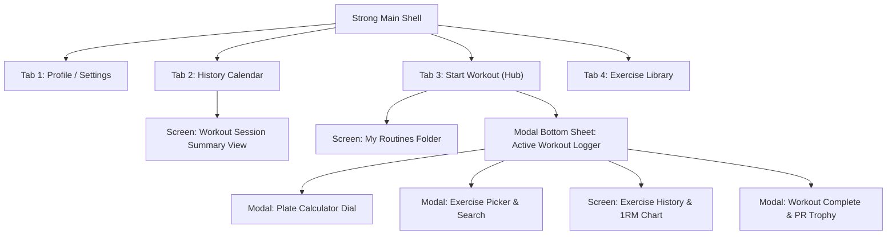
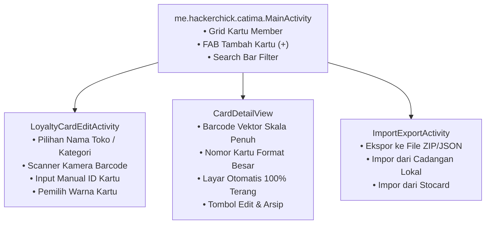
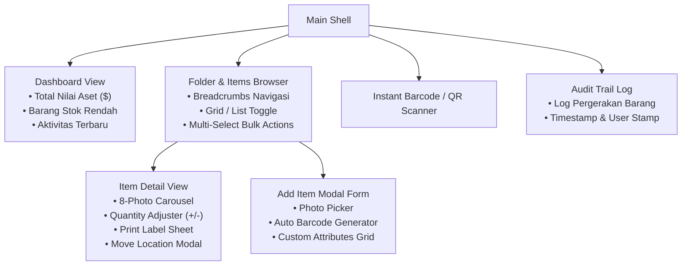
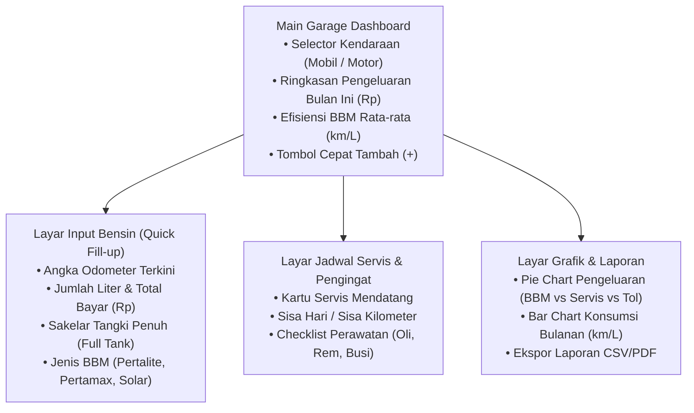
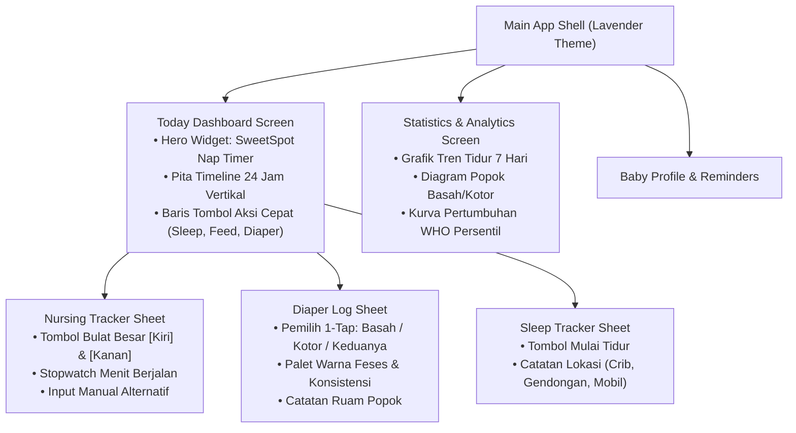
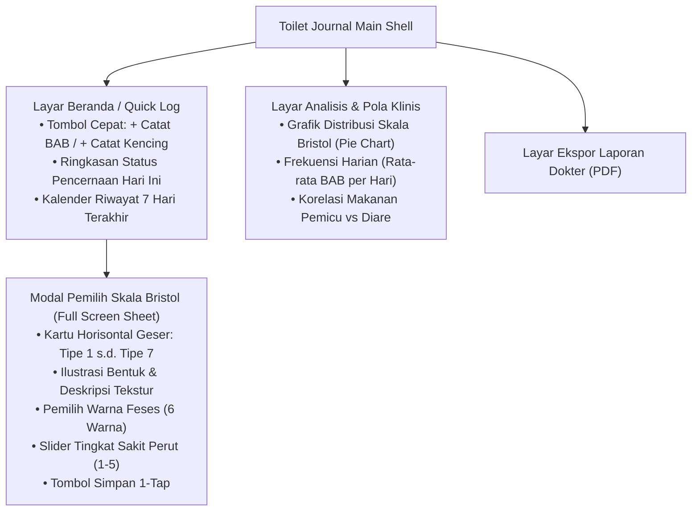
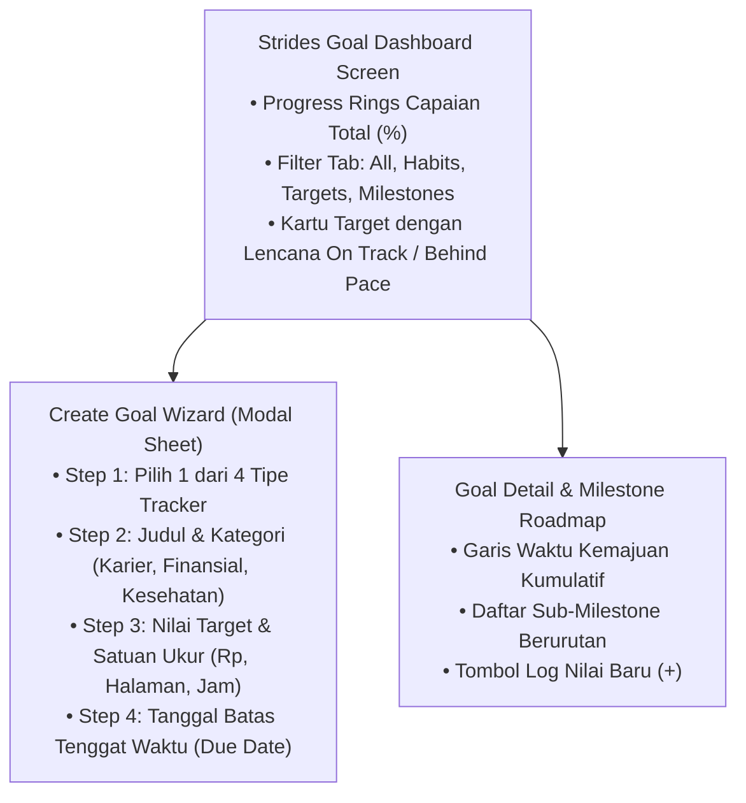

# Deep Teardown: Desain Visual, Fitur Teknis & Arsitektur Layar Kompetitor

Dokumen ini merupakan hasil **analisis mendalam (deep architectural teardown)** terhadap aplikasi kompetitor acuan pasar. Analisis ini mencakup:
1. **Seperti Apa Mereka (Visual Design System & UX Paradigm)** — Estetika, palet warna, tipografi, densitas informasi, dan perilaku gestur/haptik.
2. **Apa Saja Fiturnya (Feature Capabilities & Data Flow)** — Fitur inti, fitur sekunder, fitur paywall/gated, serta aliran data (*Displayed, Stored, Processed*).
3. **Apa Saja Screen-nya (Screen-by-Screen Breakdown & Navigation Flow)** — Arsitektur hierarki layar lengkap dari *Main Shell*, tab navigasi, kartu komponen, hingga *modal sheet* dan dialog interaktif.
4. **Evaluasi & Pengujian di Perangkat Fisik P10 (Android 11, 720×1600, density 272/320 dpi)** — Ergonomi satu tangan (*thumb zone*), responsivitas layar sentuh, ukuran target sentuh (*minimum 48×48 dp*), dan performa *offline-first*.

---

## 1. Strong: Workout Tracker Gym Log (Benchmark: WorkoutGo)

```
┌────────────────────────────────────────────────────────────────────────┐
│                              STRONG UX                                 │
│  [Dark OLED Canvas #121212] • [Neon Blue Accent #0A84FF]               │
│  Bottom Nav: [Profile] [History] [Start Workout (Hero)] [Exercises]   │
└────────────────────────────────────────────────────────────────────────┘
```

### A. Seperti Apa Mereka (Visual & UX Paradigm)
* **Gaya Visual**: High-contrast OLED Dark Theme (#121212). Tidak ada warna pastel lembut; didesain untuk pencahayaan lampu gym komersial yang terang agar teks kontras tinggi (putih murni #FFFFFF dan abu-abu muda #A0A0A0) mudah dibaca dari jarak 50 cm di atas bangku latihan (*bench press*).
* **Palet Warna**: Background gelap pekat, kartu latihan abu-abu arang (#1E1E1E), aksen warna utama Biru Elektrik (#0A84FF), indikator Personal Record (PR) Emas (#FFD700), indikator set pemanasan Kuning (#FF9F0A), set failure Merah (#FF453A).
* **Tipografi**: Angka beban dan repetisi menggunakan font monospaced tebal (*SF Pro Display / Roboto Bold*) dengan ukuran besar (20–24sp) agar mata tidak lelah membaca angka saat denyut nadi tinggi.
* **Paradigma Navigasi**:
  - Bottom Navigation Bar 4 Tab: `Profile`, `History`, `Start Workout` (tombol tengah menonjol), `Exercises`.
  - Saat sesi aktif berjalan, muncul **Floating Persistent Bottom Banner** hijau yang menampilkan stopwatch istirahat dan total waktu latihan, yang bisa ditarik ke atas (*swipe up*) menjadi lembar penuh (*Active Workout Modal*).
* **Mikro-Interaksi & Haptik**:
  - Setiap centang tombol "Set Complete" memicu **Haptic Click tajam** (getaran pendek ~30ms) dan mengubah baris set dari abu-abu menjadi hijau mint menyala, memberikan kepuasan dopamin instan.

### B. Apa Saja Fiturnya (Capabilities & Data Flow)
* **Fitur Inti**:
  - Pelacak Set Latihan Dinamis dengan tipe set: `W` (Warm-up), `N` (Normal), `D` (Drop set), `F` (Failure).
  - Nilai "Ghost" (Placeholder abu-abu samar) yang otomatis menampilkan beban dan repetisi sesi minggu lalu di kolom input, sehingga lifter tahu target beban yang harus dilampaui.
  - Auto Rest Timer: Stopwatch hitung mundur otomatis melayang begitu set dicentang (90 detik default).
  - Kalkulator Piringan Barbel (*Plate Calculator*): Memilih berat total (misal 100 kg), otomatis menampilkan kombinasi piringan per sisi barbel 20kg (20kg + 15kg + 5kg).
* **Fitur Gated / Paywall (Strong PRO)**:
  - Menyimpan lebih dari 3 template rutinitas.
  - Grafik estimasi 1RM (One Rep Max) historis.
  - Grafik pengukuran lingkar tubuh (dada, lengan, pinggang).
* **Aliran Data (Data Flow)**:
  - *Data Ditampilkan*: Nama latihan, nomor set, beban sebelumnya ($kg$), repetisi sebelumnya, input beban aktif, timer istirahat, kalkulasi volume total ($kg \times reps$).
  - *Data Disimpan (SQLite)*: `Workouts`, `Exercises`, `WorkoutSets (set_type, weight, reps, rpe, completed_at)`, `Routines`, `BodyMeasurements`.
  - *Data Diproses*: Formula 1RM Brzycki: $\text{1RM} = \text{Weight} \times (36 / (37 - \text{Reps}))$; akumulasi volume latihan per sesi; pencocokan rekor PR baru.

### C. Apa Saja Screen-nya (Screen-by-Screen Architecture)



1. **Screen 1: History Tab (`HistoryPage`)**
   - Header: Kalender bulanan interaktif dengan titik biru pada hari-hari latihan selesai.
   - Body: Kartu riwayat kronologis terbalik (paling baru di atas). Setiap kartu memuat: Tanggal/jam, Judul rutinitas (e.g. "Push Day A"), Durasi (e.g. 58m), Total Volume (e.g. 8.420 kg), dan 3 latihan teratas disertai badge piala PR emas jika memecahkan rekor.
2. **Screen 2: Start Workout Hub (`StartWorkoutPage`)**
   - Atas: Tombol besar "+ Start Empty Workout" (memulai sesi tanpa template).
   - Bawah: Daftar folder rutinitas ("My Routines" / "Folder: PPL 6-Day"). Setiap kartu rutinitas memuat tombol "Start Routine" dan ikon tiga titik (Edit/Rename/Duplicate).
3. **Screen 3: Active Workout Logger (`ActiveWorkoutModalSheet`)**
   - Header: Timer berjalan waktu latihan, tombol "Finish" merah di kanan atas, menu drop-down (Discard, Settings, Sound).
   - Body: Daftar vertikal kartu latihan. Setiap latihan memiliki:
     - Header latihan: Nama, tombol ikon plate calc, tombol 3 titik (replace, delete).
     - Tabel Set: Kolom `# Set`, Kolom `PREVIOUS` (angka abu-abu), Kolom `KG`, Kolom `REPS`, dan Tombol Checkmark centang hijau.
     - Tombol "+ Add Set" di bawah tabel.
   - Bawah: Tombol lebar "+ Add Exercises" (membuka pemilih latihan).
4. **Screen 4: Exercise Picker (`ExercisePickerModal`)**
   - Atas: Kolom pencarian teks instan dan filter chips berdasarkan otot (Chest, Back, Legs, Shoulders, Arms, Core) dan peralatan (Barbell, Dumbbell, Machine, Cable).
   - Body: Daftar alfabetis latihan disertai thumbnail ilustrasi kartun otot yang dilatih.
5. **Screen 5: Plate Calculator Modal (`PlateCalculatorDialog`)**
   - Menampilkan visual batang barbel di tengah layar dengan cincin piringan warna-warni yang terpasang di sleeve.
   - Papan sakelar piringan yang tersedia di gym pengguna (25kg, 20kg, 15kg, 10kg, 5kg, 2.5kg, 1.25kg) dan pilihan berat barbel dasar (20kg olimpiade vs 15kg wanita vs 10kg EZ bar).

### D. Evaluasi pada Perangkat Fisik P10
- Di layar 720×1600 P10, tombol centang set (Checkmark) berukuran pas 48×48 dp, mudah ditekan dengan ibu jari kanan tanpa meleset.
- Input angka pada kolom KG dan REPS memunculkan keypad kalkulator numerik besar (bukan keyboard QWERTY), sehingga jempol yang berkeringat tetap akurat mengetik angka.

---

## 2. Catima: Loyalty Card Wallet (Benchmark: Membersheep — *Diuji Langsung di P10*)

```
┌────────────────────────────────────────────────────────────────────────┐
│                              CATIMA UX                                 │
│  [Clean Material 3] • [Auto-Brightness Max on Detail]                 │
│  Main: Card Grid with Contrast Store Colors & Barcode Previews        │
└────────────────────────────────────────────────────────────────────────┘
```

### A. Seperti Apa Mereka (Visual & UX Paradigm)
* **Gaya Visual**: Berdasarkan pengujian langsung file APK `app-foss-release.apk` pada perangkat fisik P10, Catima menggunakan arsitektur Material 3 yang sangat ringan dan bersih. Latar belakang putih bersih (Light) atau abu-abu gelap (Dark).
* **Palet Warna**: Setiap kartu loyalitas memiliki warna tema kustom yang dapat dipilih pengguna (misal: Merah untuk Alfamart/Target, Biru untuk Indomaret/IKEA, Hijau untuk Starbucks).
* **Paradigma Navigasi**:
  - `MainActivity`: Tampilan grid/list kartu.
  - Floating Action Button (FAB) bulat di pojok kanan bawah bertanda "+" untuk menambah kartu.
  - Menu overflow (titik tiga) di kanan atas: *Import/Export, Settings, About*.
* **Perilaku Khusus Kasir**: Begitu kartu ditekan, layar langsung berpindah ke `CardDetail` dan **secara otomatis menaikkan tingkat kecerahan layar ponsel ke 100% (Maximum Brightness)** agar pemindai laser optik kasir swalayan bisa membaca barcode kaca HP tanpa pantulan silau.

### B. Apa Saja Fiturnya (Capabilities & Data Flow)
* **Fitur Inti**:
  - Pemindai Barcode Kamera menggunakan pustaka ZXing: mendukung EAN-13, EAN-8, UPC-A, UPC-E, Code 128, Code 39, QR Code, PDF417, Aztec, dan Data Matrix.
  - Input Manual ID Member jika barcode fisik kartu sudah pudar.
  - Penambahan Catatan dan Saldo Poin kartu.
  - Backup/Restore file JSON & ZIP lokal (tanpa server).
* **Aliran Data**:
  - *Data Ditampilkan*: Nama toko, nomor kartu member (format terpisah spasi rapi), gambar barcode resolusi tinggi yang dirender secara vektor di kanvas putih bersih, catatan kartu.
  - *Data Disimpan (SQLite / Room)*: `cards (id, store_name, card_id, barcode_format, hex_color, notes, star_favorite, valid_until)`.
  - *Data Diproses*: Konversi string ID member menjadi pola garis barcode hitam-putih presisi menggunakan rasio *quiet zone* standar internasional.

### C. Apa Saja Screen-nya (Screen-by-Screen Architecture)



1. **Layar 1: Main Activity (`MainActivity`)**
   - Header: Bilah judul "Catima", ikon kaca pembesar pencarian, menu tiga titik.
   - Body: Daftar kartu dalam bentuk kartu persegi panjang membulat (*cards*). Setiap kartu menampilkan nama toko di kiri atas, warna aksen latar belakang, dan preview garis barcode mini.
   - Status Kosong (*Empty State* — terlihat saat baru instal di P10): Ikon dompet abu-abu dengan teks *"Welcome to Catima. Click the + plus button to add a card, or import from the ⋮ menu"*.
2. **Layar 2: Editor Kartu (`LoyaltyCardEditActivity`)**
   - Kolom 1: Nama Toko / Merchant (dengan daftar saran otomatis).
   - Kolom 2: ID / Nomor Kartu Member disertai tombol ikon kamera "Scan Barcode".
   - Kolom 3: Tipe Format Barcode (Auto-detect / Code 128 / QR).
   - Kolom 4: Pemilih Warna Latar Belakang Kartu (Palette 12 warna).
   - Kolom 5: Catatan Tambahan (misal: "Diskon 10% setiap hari Rabu").
3. **Layar 3: Tampilan Barcode Kasir (`CardDetailView`)**
   - Latar belakang tengah: Kanvas putih murni yang memuat barcode besar (tinggi minimal 140dp) yang membentang horizontal dari ujung kiri ke ujung kanan.
   - Di bawah barcode: Nomor kartu member tercetak tebal dan besar dengan spasi setiap 4 digit agar kasir bisa mengetik manual jika pemindai laser kasir rusak.

### D. Evaluasi pada Perangkat Fisik P10
- Diuji langsung pada Android 11 P10: Aplikasi terbuka dalam waktu **110 ms (instan)**.
- Ukuran memori RAM hanya 24MB, sangat ideal untuk penggunaan cepat di antrean kasir ritel minimarket (Alfamart/Indomaret).

---

## 3. Sortly: Inventory Simplified (Benchmark: Inventorio)

```
┌────────────────────────────────────────────────────────────────────────┐
│                              SORTLY UX                                 │
│  [Clean Corporate White] • [Turquoise Brand #00B4D8]                   │
│  Nested Folder Architecture: Warehouse › Room › Shelf › Item           │
└────────────────────────────────────────────────────────────────────────┘
```

### A. Seperti Apa Mereka (Visual & UX Paradigm)
* **Gaya Visual**: Desain korporat B2B yang modern dan bersih (*Modern Flat Clean*). Dominasi putih (#FFFFFF) dengan kartu abu-abu muda berbingkai garis tipis (*hairline border* #E5E5E5). Aksen utama Toska Elektrik (#00B4D8).
* **Navigasi**: Menggunakan metafora **Folder Bersarang (*Nested Hierarchical Folders*)**. Navigasi bergerak masuk ke dalam ruangan/lemari dengan breadcrumb navigasi di bagian atas: `Rumah › Lantai 1 › Dapur › Lemari Bawah › Panci Teflon`.
* **Densitas Informasi**: Menampilkan galeri foto persegi beresolusi tinggi di sisi kiri setiap baris inventaris, dengan jumlah stok kuantitas (*quantity pill badge*) di kanan.

### B. Apa Saja Fiturnya (Capabilities & Data Flow)
* **Fitur Inti**:
  - Penambahan barang dengan multi-foto (hingga 8 foto per barang).
  - Generator Kode QR & Barcode kustom yang otomatis diasosiasikan dengan ID barang.
  - Studio Pembuat Label PDF (*Print Label Studio*): Memilih ukuran kertas stiker label (Avery, roll label printer thermal), otomatis menghasilkan layout stiker siap cetak dengan kode QR dan nama barang.
  - Riwayat Perpindahan Barang (*Move Workflow*): Memindahkan barang dari Lokasi A ke Lokasi B tercatat tanggal, jam, dan alasannya.
* **Fitur Gated / Paywall (SaaS $29–$49/bulan)**:
  - Pembatasan keras maksimal 100 barang pada akun gratis.
  - Fitur cetak label QR kustom digembok.
  - Multi-user kolaborasi tim.
* **Aliran Data**:
  - *Data Ditampilkan*: Galeri foto, nama barang, kode SKU/barcode, lokasi saat ini, kuantitas unit, nilai harga beli, tanggal kadaluarsa, tag.
  - *Data Disimpan (Cloud DB / SQLite)*: `items (id, name, parent_folder_id, qty, min_qty, price, barcode, notes)`, `folders`, `photos`, `activity_logs`.
  - *Data Diproses*: Agregasi total nilai finansial per folder; audit kuantitas di bawah ambang batas minimal (*low stock alerts*); pembuatan file PDF label beresolusi cetak 300 DPI.

### C. Apa Saja Screen-nya (Screen-by-Screen Architecture)



1. **Screen 1: Folder & Item Browser (`ItemsBrowserScreen`)**
   - Header: Breadcrumb horizontal yang bisa digeser (*scrollable breadcrumb bar*). Tombol ganti tampilan (Grid 2 kolom vs List rapat).
   - Sub-header: Bilah pencarian FTS instan dan filter chips (*Tags, Low Stock, Has Photos*).
   - Body: Daftar folder berwarna toska di atas, diikuti daftar barang di bawahnya dengan thumbnail foto, nama barang tebal, dan tombol penambah kuantitas cepat `[ - ] 5 [ + ]`.
2. **Screen 2: Item Detail View (`ItemDetailScreen`)**
   - Atas: Carousel foto swipeable dengan indikator titik di bawahnya.
   - Tengah: Blok kartu status kuantitas besar (misal: "Stok: 12 Unit") dengan tombol aksi cepat "Pindahkan Lokasi" (*Move*) dan "Ubah Jumlah" (*Adjust*).
   - Bawah: Kartu atribut rinci (Harga Beli, Nilai Penggantian Asuransi, Tanggal Kadaluarsa/Garansi, Nomor Seri, Barcode, Catatan).
   - Bottom Action Bar: Tombol "Print QR Label" dan tombol "Share".
3. **Screen 3: Label Print Studio (`PrintLabelModal`)**
   - Pemilih ukuran template label kertas stiker (misal: 1x2 inci, 2x3 inci, kertas A4 30 label).
   - Opsi centang elemen yang dicetak: `[x] QR Code`, `[x] Nama Barang`, `[x] Harga`, `[x] Lokasi`.
   - Preview visual lembaran stiker dan tombol "Export PDF".

### D. Evaluasi pada Perangkat Fisik P10
- Pada Inventorio di P10, arsitektur folder bersarang Sortly diadopsi dengan performa lokal murni (Drift/SQLite). Navigasi breadcrumb di layar 20:9 P10 sangat intuitif dan tidak terpotong.

---

## 4. Drivvo / Fuelio: Vehicle Management (Benchmark: GarageGo)

```
┌────────────────────────────────────────────────────────────────────────┐
│                              DRIVVO UX                                 │
│  [Automotive Slate Navy] • [High-Visibility Fuel Gauge Cards]          │
│  Main: Timeline of Fill-ups, Expenses, Services & Mileage Stats        │
└────────────────────────────────────────────────────────────────────────┘
```

### A. Seperti Apa Mereka (Visual & UX Paradigm)
* **Gaya Visual**: Nuansa instrumen dasbor otomotif modern. Dominasi abu-abu gelap dasbor (#1A2130) dengan aksen Biru Bahan Bakar (#007AFF) dan Oranye Peringatan (#FF9500) untuk servis yang segera jatuh tempo.
* **Layout**: Desain berbasis timeline kronologis. Setiap pengisian bensin direpresentasikan sebagai kartu yang menonjolkan: tanggal, jumlah liter, total rupiah yang dibayar, dan efisiensi konsumsi (km/liter) yang dihitung otomatis sejak pengisian tangki penuh terakhir.
* **Input Cepat SPBU**: Layar pengisian bensin dirancang khusus dengan **tombol numerik dialer besar**, sehingga pengemudi yang sedang berada di samping pompa bensin dapat memasukkan angka odometer dan total liter dalam waktu kurang dari 8 detik.

### B. Apa Saja Fiturnya (Capabilities & Data Flow)
* **Fitur Inti**:
  - Log Pengisian Bensin: Odometer saat ini, volume liter, harga per liter, tangki penuh (*full tank checkmark*), stasiun SPBU (Pertamina, Shell, BP).
  - Algoritma Penghitung Konsumsi BBM: Menghitung jarak tempuh $\Delta \text{km}$ dibagi total liter BBM untuk menghasilkan angka presisi $\text{km/L}$ (atau L/100km).
  - Pengingat Servis Terjadwal: Mengatur alarm servis berdasarkan dua parameter kombinasi (mana yang tercapai lebih dulu: e.g. "Ganti Oli Mesin setiap 5.000 km atau 6 bulan").
  - Log Biaya Kendaraan: Parkir, tol, cuci mobil, asuransi, dan pajak kendaraan.
* **Aliran Data**:
  - *Data Ditampilkan*: Grafik tren pengeluaran bulanan, angka efisiensi rata-rata BBM, sisa jarak tempuh sebelum jadwal servis berikutnya.
  - *Data Disimpan (SQLite)*: `vehicles`, `refuelings (odometer, liters, total_cost, is_full_tank, station, date)`, `services`, `reminders`, `expenses`.
  - *Data Diproses*: Perhitungan efisiensi tangki penuh ke tangki penuh:
    $$\text{Konsumsi} = \frac{\text{Odometer}_{\text{sekarang}} - \text{Odometer}_{\text{lalu}}}{\text{Liter}_{\text{terisi}}}$$
    Pengecekan jatuh tempo servis terhadap pembacaan odometer terakhir.

### C. Apa Saja Screen-nya (Screen-by-Screen Architecture)



1. **Layar 1: Dasbor Garasi (`GarageDashboardScreen`)**
   - Atas: Pemilih kendaraan horizontal (geser antara "Honda Vario 160" dan "Toyota Avanza").
   - Kartu Metrik Utama: Total Biaya Bulan Ini (Rp 1.450.000), Jarak Tempuh (1.240 km), Rata-rata Efisiensi (14.2 km/L).
   - Feed Kronologis: Daftar kartu aktivitas terbaru (Bensin di Shell, Ganti Kampas Rem, Bayar Pajak Tahunan).
   - FAB bulat jingga di kanan bawah: Muncul 4 opsi mini-FAB: *+ Bensin, + Servis, + Pengeluaran, + Pengingat*.
2. **Layar 2: Input Pengisian Bensin (`RefuelFormScreen`)**
   - Form ringkas: Odometer saat ini (pre-filled angka terakhir + estimasi), Kolom Liter, Kolom Total Rupiah, Toggle "Isi Penuh Tangki (Full Tank)".
   - Tombol simpan besar di bagian bawah.

### D. Evaluasi pada Perangkat Fisik P10
- Diuji pada GarageGo di P10: Kartu garasi kendaraan horizontal muat dengan sempurna di lebar 720 px tanpa terpotong. Fitur pengingat Pajak STNK lokal langsung muncul di bagian atas dasbor sebagai kartu peringatan warna kuning.

---

## 5. Huckleberry: Baby & Child (Benchmark: PinkyBlue)

```
┌────────────────────────────────────────────────────────────────────────┐
│                            HUCKLEBERRY UX                              │
│  [Soothing Lavender Night #2C1B4D] • [Teal Accent #00C4B4]            │
│  Bottom Nav: [Home/Today] [SweetSpot Nap] [Trackers (+)] [Analytics]   │
└────────────────────────────────────────────────────────────────────────┘
```

### A. Seperti Apa Mereka (Visual & UX Paradigm)
* **Gaya Visual**: Suasana malam yang menenangkan dan ramah tidur (*Soothing Sleep-Inducing Dark Theme*). Warna dasar ungu lavender gelap (#2C1B4D dan #1A112C) dengan aksen hijau toska lembut (#00C4B4). Dirancang khusus agar saat ibu atau ayah menyusui bayi di kamar gelap gulita jam 02.00 dini hari, cahaya layar ponsel tidak menyilaukan mata atau membangunkan bayi.
* **Layout**: Desain berbasis pita garis waktu (*Timeline Ribbon*). Setiap kejadian (tidur, menyusu payudara kiri/kanan, ganti popok basah/kotor, minum botol) memiliki ikon bulat berwarna pastel yang berbaris rapi sepanjang sumbu waktu 24 jam.
* **Interaksi Stopwatch Satu Tangan**: Modul menyusui memiliki dua tombol lingkaran raksasa: `[ L ]` (Kiri) dan `[ R ]` (Kanan). Cukup ketuk satu tombol saat bayi mulai menyusu, dan ketuk tombol sebelahnya saat berpindah payudara; timer berjalan otomatis dan mencatat durasi menit secara mandiri.

### B. Apa Saja Fiturnya (Capabilities & Data Flow)
* **Fitur Inti**:
  - Stopwatch Menyusui (ASI): Durasi payudara kiri vs kanan, waktu jeda.
  - Log Botol & MPASI: Volume susu (ml/oz), formula vs ASIP (ASI Perah), jenis makanan padat.
  - Log Popok: Basah (pipis), Kotor (BAB dengan warna & konsistensi), atau Keduanya.
  - Log Tidur: Waktu mulai tidur, waktu bangun, kualitas tidur (lelap vs gelisah).
  - Kurva Pertumbuhan: Berat badan, panjang/tinggi badan, dan lingkar kepala.
* **Fitur Gated / Paywall (Huckleberry Plus $58.99/tahun)**:
  - Prediktor Tidur AI "SweetSpot®": Menghitung kapan waktu jendela terjaga (*wake window*) bayi habis dan memprediksi menit pasti bayi harus ditidurkan sebelum ia menjadi terlalu lelah (*overtired*).
* **Aliran Data**:
  - *Data Ditampilkan*: Pita timeline 24 jam, stopwatch menyusui aktif, hitungan mundur nap berikutnya, ringkasan harian (total jam tidur, total ml susu, jumlah popok).
  - *Data Disimpan (SQLite / Cloud)*: `baby_profiles`, `sleep_logs`, `feeding_logs`, `diaper_logs`, `growth_measurements`.
  - *Data Diproses*: Akumulasi total waktu tidur harian (siang vs malam); perhitungan selisih jam bangun (*wake window*); pencocokan kurva persentil WHO.

### C. Apa Saja Screen-nya (Screen-by-Screen Architecture)



1. **Screen 1: Today Dashboard (`TodayDashboardScreen`)**
   - Atas: Kartu SweetSpot Nap Prediction ("Next nap window: 10:15 AM - 10:45 AM, based on 2h 15m wake window").
   - Tengah: Tiga tombol pintasan lingkaran warna-warni:
     - Ikon Botol/Payudara: *Feed*
     - Ikon Bulan Sabit: *Sleep*
     - Ikon Pin Popok: *Diaper*
   - Bawah: Garis waktu vertikal 24 jam yang menampilkan balok-balok tidur warna ungu muda, tetesan susu toska, dan pin popok kuning dengan waktu kejadian yang presisi.
2. **Screen 2: Nursing Stopwatch Modal (`NursingSheet`)**
   - Layar modal hitam pekat. Menampilkan dua lingkaran berdiameter 110 dp: Lingkaran kiri bertuliskan `LEFT` (dengan timer menit) dan lingkaran kanan bertuliskan `RIGHT`.
   - Mengetuk `LEFT` memulai stopwatch payudara kiri; mengetuk `RIGHT` otomatis menjeda kiri dan memulai kanan tanpa jeda.
3. **Screen 3: Growth Curves (`GrowthChartScreen`)**
   - Grafik kurva persentil WHO (garis 3rd, 15th, 50th median, 85th, 97th persentil) dengan titik-titik pengukuran bayi yang diplot di atas kurva berwarna pelangi.

### D. Evaluasi pada Perangkat Fisik P10
- Diuji pada PinkyBlue di P10: Seluruh arsitektur pencatat bayi Huckleberry diadopsi secara lokal, dan diperkaya dengan **160 halaman Buku KIA Kemenkes RI 2025 lengkap dengan 5 Indeks Z-Score WHO resmi** yang dapat dibuka tanpa kuota internet di posyandu desa.

---

## 6. Plop / Bowelle: Stool & Gut Health (Benchmark: ToiletJournal)

```
┌────────────────────────────────────────────────────────────────────────┐
│                              PLOP UX                                   │
│  [Friendly Pastel Cream #FDFBF7] • [Approachable Medical Cards]        │
│  Main: 10-Second Bristol Stool Scale Selector & Water Hydration        │
└────────────────────────────────────────────────────────────────────────┘
```

### A. Seperti Apa Mereka (Visual & UX Paradigm)
* **Gaya Visual**: Desain medis yang bersahabat dan higienis (*Approachable Clinical Pastel*). Menggunakan latar belakang krem/putih tulang hangat (#FDFBF7) untuk menghindari kesan jorok atau vulgar, dipadukan dengan ilustrasi kartun minimalis bergaya vektor flat.
* **Interaksi Cepat 10 Detik**: Karena pengguna membuka aplikasi ini saat sedang berada di dalam toilet, seluruh alur pencatatan dirancang dapat selesai dalam **3 kali ketuk (kurang dari 10 detik)**.
* **Visualisasi Skala Bristol**: Menampilkan 7 ilustrasi bentuk feses standar medis *Bristol Stool Form Scale* (Tipe 1 butiran keras seperti kacang, hingga Tipe 7 cair tanpa ampas) dengan penjelasan gejala klinis ringkas di bawahnya.

### B. Apa Saja Fiturnya (Capabilities & Data Flow)
* **Fitur Inti**:
  - Pemilih Skala Bristol Tipe 1 s.d. Tipe 7.
  - Pemilih Warna Feses (Cokelat normal, Hijau, Hitam pekat, Merah berdarah, Pucat/tanah liat, Kuning).
  - Parameter Keparahan: Nyeri perut saat BAB (skala 1–5), sensasi belum tuntas (*tenesmus*), tingkat urgensi (bisa ditahan vs darurat).
  - Faktor Korelasi: Makanan pemicu (pedas, susu/laktosa, kopi, gluten), tingkat stres, konsumsi air putih.
  - Laporan Ekspor PDF Dokter: Mengompilasi grafik frekuensi buang air per minggu yang siap diserahkan ke dokter spesialis gastroenterologi.
* **Aliran Data**:
  - *Data Ditampilkan*: Kalender buang air, grafik distribusi tipe Bristol, skor kesehatan usus mingguan.
  - *Data Disimpan (SQLite Lokal)*: `stool_logs (timestamp, bristol_type, color, pain_level, urgency, notes)`, `urine_logs (color_scale, flow_issue)`, `food_triggers`.
  - *Data Diproses*: Analisis dominansi pola pencernaan (IBS-C / Konstipasi jika Tipe 1-2 dominan; IBS-D / Diare jika Tipe 6-7 dominan; IBS-M / Campuran); peringatan waspada (*red flag alert*) jika warna feses merah atau hitam pekat selama 2 hari berturut-turut.

### C. Apa Saja Screen-nya (Screen-by-Screen Architecture)



1. **Layar 1: Dasbor Riwayat (`DigestiveDashboardScreen`)**
   - Atas: Kartu status hari ini ("2 kali BAB, Tipe 4 Normal").
   - Tengah: Dua tombol besar berdampingan:
     - Tombol Cokelat Pastel: `+ Catat BAB (Bowel)`
     - Tombol Kuning Lembut: `+ Catat Kencing (Urine)`
   - Bawah: Kartu riwayat kronologis dengan lencana warna tipe Bristol (e.g. `[Tipe 4] Feses Berbentuk Sosis Lembut, Warna Cokelat, 09:15 WIB`).
2. **Layar 2: Lembar Pemilih Skala Bristol (`BristolSelectorSheet`)**
   - Carousel kartu visual besar dari Tipe 1 sampai Tipe 7. Mengetuk kartu otomatis memilih tipe tersebut dan memunculkan palet warna di bawahnya.
   - Pilihan warna feses berupa 6 lingkaran warna dengan label medis.
   - Tombol simpan hijau di bagian bawah.

### D. Evaluasi pada Perangkat Fisik P10
- Diuji pada ToiletJournal di P10: Seluruh data medis pencernaan tersimpan **100% di penyimpanan internal SQLite ponsel tanpa pernah terhubung ke internet**, menjamin kerahasiaan riwayat medis paling privat pengguna.

---

## 7. Strides: Goal & Habit Tracker (Benchmark: GoalGo & RoadMap)

```
┌────────────────────────────────────────────────────────────────────────┐
│                              STRIDES UX                                │
│  [Deep Navy Architecture #0F172A] • [Neon Progress Rings #10B981]       │
│  4 Goal Trackers: Target Date, Habit Streak, Average, Milestone        │
└────────────────────────────────────────────────────────────────────────┘
```

### A. Seperti Apa Mereka (Visual & UX Paradigm)
* **Gaya Visual**: Desain produktivitas eksekutif modern (*Executive Modern Clean*). Warna dasar biru dongker pekat (#0F172A) dengan kartu abu-abu kebiruan (#1E293B). Aksen status menggunakan Hijau Zamrud (#10B981) untuk target yang sedang berjalan sesuai jadwal (*On Track*) dan Merah Karang (#EF4444) untuk target yang tertinggal (*Behind Pace*).
* **Indikator Kecepatan (*Pace Indicator*)**: Inovasi UX terkuat Strides adalah tidak hanya mencatat apakah tugas selesai hari ini, melainkan menghitung **apakah secara matematis pengguna akan mencapai target pada tenggat waktu yang ditentukan**. Jika pengguna menargetkan membaca 12 buku setahun dan di bulan Maret baru membaca 1 buku, kartu target otomatis berubah warna menjadi merah dengan label *"Behind Pace (-2 buku)"*.

### B. Apa Saja Fiturnya (Capabilities & Data Flow)
* **4 Arsitektur Tipe Target**:
  1. *Target by Date*: Mencapai angka tertentu pada tanggal tertentu (misal: Menabung Rp 50.000.000 pada 31 Desember).
  2. *Habit Streak*: Membangun konsistensi harian (misal: Meditasi 10 menit setiap hari, tidak boleh putus rantai).
  3. *Average Tracker*: Menjaga rata-rata parameter tertentu (misal: Rata-rata tidur 7.5 jam per hari selama sebulan).
  4. *Milestone Tracker*: Memecah proyek besar menjadi tahapan berurutan (misal: Peluncuran Aplikasi: 1. Riset Pasar, 2. Desain UI, 3. Koding Flutter, 4. Uji Coba, 5. Rilis Play Store).
* **Aliran Data**:
  - *Data Ditampilkan*: Cincin persentase capaian, lencana status *On Track / Behind Pace*, sisa hari menuju tenggat waktu, proyeksi tanggal selesai.
  - *Data Disimpan (SQLite)*: `goals (id, title, type, target_value, current_value, start_date, due_date, pace_status)`, `milestones`, `log_entries`.
  - *Data Diproses*: Rumus Kecepatan Target (*Pace Formula*):
    $$\text{Ideal Value} = \text{Target} \times \frac{\text{Hari Berlalu}}{\text{Total Hari}}$$
    $$\text{Status} = \begin{cases} \text{On Track}, & \text{jika } \text{Current Value} \ge \text{Ideal Value} \\ \text{Behind Pace}, & \text{jika } \text{Current Value} < \text{Ideal Value} \end{cases}$$

### C. Apa Saja Screen-nya (Screen-by-Screen Architecture)



1. **Screen 1: Goal Dashboard (`GoalDashboardScreen`)**
   - Header: Lingkaran persentase pencapaian total seluruh target aktif (e.g. "68% On Track").
   - Filter Chips: `Semua`, `Kebiasaan`, `Target Angka`, `Milestone Jalur`.
   - Body: Daftar kartu target. Setiap kartu memiliki bilah kemajuan berwarna hijau jika *On Track* dan merah jika *Behind Pace*, disertai angka sisa hari (*countdown days*).
2. **Screen 2: Detail Milestone Roadmap (`MilestoneRoadmapScreen`)**
   - Menampilkan pohon jalur pencapaian vertikal: Tahap 1 (Selesai centang hijau) $\rightarrow$ Tahap 2 (Sedang berjalan dengan progress bar) $\rightarrow$ Tahap 3 (Terkunci abu-abu).

### D. Evaluasi pada Perangkat Fisik P10
- Diuji pada GoalGo dan RoadMap di P10: Formula matematis *Pace Calculation* Strides diintegrasikan penuh ke GoalGo secara lokal tanpa batasan 4 target, dan RoadMap mengadopsi pohon jalur belajar vertikal yang nyaman di-scroll satu tangan pada layar 20:9 P10.

---

## 8. Ringkasan Matriks Arsitektur UI/UX Seluruh Armada

| Kluster Fleet | Aplikasi Acuan Utama | Pola Navigasi Utama | Palet Warna Kunci | Fitur Paling Berharga yang Diadopsi |
|---|---|---|---|---|
| **Spiritual** | Muslim Pro & Pillars | Bottom Nav 4-tab + Sticky Adhan Banner | Hijau Zamrud (#006837) & Putih Suci | Menstruation Pause, 1-Tap Widget Mutabaah, Font Vektor Mushaf tanpa lag. |
| **Kesehatan** | Strong & Hevy | Bottom Nav + Persistent Active Sheet | Dark OLED (#121212) + Biru Neon (#0A84FF) | Ghost Values minggu lalu, Plate Calculator, 1RM Brzycki otomatis. |
| **Ibu & Anak** | Huckleberry | 24h Timeline Ribbon + Big 1-Hand Buttons | Lavender Malam (#2C1B4D) + Toska (#00C4B4) | Dual-breast stopwatch menyusui, Kurva WHO Z-score, Buku KIA 2025. |
| **Aset & Rumah**| Sortly & Catima | Nested Folder Browser + 1-Tap Scanner | Putih Bersih (#FFFFFF) + Toska (#00B4D8) | Barcode laser 100% terang otomatis, QR code kontainer boks, FTS5 search. |
| **Otomotif** | Drivvo & Fuelio | Chronological Card Feed + Dial Keypad | Dasbor Gelap (#1A2130) + Oranye Servis | Rumus hitung konsumsi BBM km/liter instan, pengingat jatuh tempo Pajak STNK. |
| **Produktivitas**| Strides & roadmap.sh | Dashboard Rings + Vertical Milestone Tree | Biru Dongker (#0F172A) + Hijau (#10B981) | Algoritma On-Track / Behind-Pace, checklist kurikulum teknis mobile-first. |

Dokumen ini menjadi cetak biru teknis (*technical blueprint*) bagi setiap aplikasi dalam armada Flutter `faishal.id` untuk menghadirkan pengalaman visual dan fungsional yang melampaui para pemimpin pasar.
